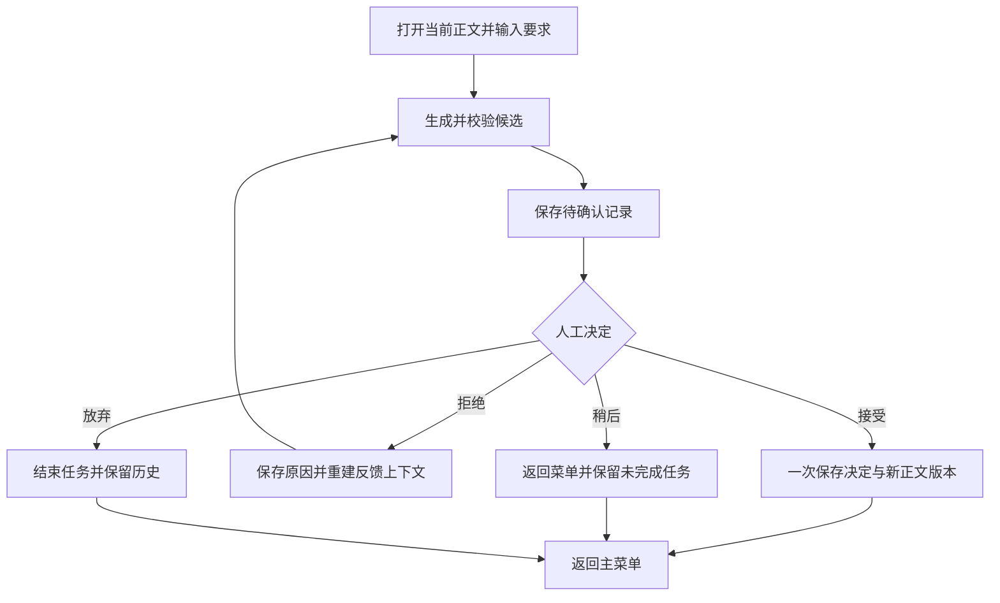

# 01Writing

01Writing 是一个带人工反馈和正文版本管理的 AI 辅助写作工具。为文档提出修改要求，DeepSeek 生成一个候选；接受后保存新正文版本，拒绝后带着反馈重新生成。全部候选、决定和正文版本保存在本地，可以重启后继续未完成任务，也可以恢复旧正文。

## 版本状态

当前代码对应 **v0.2.0**，版本标签与正式发布记录以 [GitHub Releases](https://github.com/SenTomKing/01Writing/releases) 为准。

- 持续主菜单：一次启动可完成多个操作，选择 `0` 退出。
- 文档管理：创建、列出、打开文档，查看完整正文版本。
- 按要求修订：当前正文、修改要求和历次拒绝反馈共同组成模型上下文。
- 人工决定：接受、拒绝并重试、稍后处理或放弃任务。
- 任务恢复：重启后确认已有候选，无须再次调用模型；重试时重建完整反馈链。
- 版本恢复：复制旧正文成为新的版本，保留已有历史。
- 冲突保护：当前正文已经变化时，旧候选不能覆盖新正文。
- 独立修订及历史查看：兼容旧版数据，不自动把旧记录归入新文档。
- 离线演示：不读取 `.env`，不调用真实模型，使用单独的数据文件。

## 安装与启动

需要 Python 3.11 或更高版本。在项目根目录的 PowerShell 中执行：

```powershell
python -m venv .venv
.\.venv\Scripts\python.exe -m pip install -e .
.\.venv\Scripts\python.exe main.py --demo
```

已有合适环境时，可直接执行 `python -m pip install -e .` 和 `python main.py --demo`。安装后也可通过 `writing-assistant` 或 `python -m writing_assistant` 启动。

离线演示候选只添加演示标记，用于验证流程，**不代表真实改写质量**。演示数据保存在 `data/demo-project.json`，正式模式默认使用 `data/revisions.json`。

## 配置真实模型

首次配置时复制 `.env.example` 为 `.env`；已有 `.env` 时保留现有文件。将其中的密钥占位值替换为自己的 DeepSeek API key，然后运行：

```powershell
python main.py
```

| 配置项 | 含义 | 默认值 |
| --- | --- | --- |
| `DEEPSEEK_API_KEY` | 模型密钥；生成新候选时需要 | 无 |
| `DEEPSEEK_BASE_URL` | 兼容 API 地址 | `https://api.deepseek.com` |
| `DEEPSEEK_MODEL` | 模型名称，应使用账户可用名称 | `deepseek-flash` |
| `WRITING_DATA_FILE` | 本地数据文件，相对路径以项目根目录为起点 | `data/revisions.json` |
| `WRITING_MAX_INPUT_CHARS` | 原文和初始正文字符上限 | `10000` |
| `DEEPSEEK_TIMEOUT_SECONDS` | 请求超时秒数 | `60` |

文档管理、历史查看、版本恢复和确认已有候选不需要密钥。当前模型调用使用 JSON 输出与关闭思考的兼容参数；服务支持情况由所配置模型决定。输入文字及反馈会发送给配置的模型服务。

## 使用

先选 `3` 创建文档，选 `4` 复制文档编号，再选 `6` 输入编号及修改要求。

候选出现后：`y` 接受并结束本轮，`n` 输入拒绝原因并继续生成，`p` 保存后稍后处理，`x` 放弃任务。接受后返回主菜单；如需新的修改目标，再次选择 `6`。

| 菜单 | 操作 |
| --- | --- |
| 1 / 2 | 新建独立修订 / 查看全部修订历史 |
| 3 / 4 / 5 | 创建文档 / 查看文档列表 / 打开当前正文 |
| 6 / 7 / 8 | 修改文档 / 查看正文版本 / 恢复旧正文 |
| 9 / 10 / 11 | 查看未完成任务 / 继续任务 / 查看修订详情 |
| 12 / 0 | 查看一篇文档的修订历史 / 退出 |

恢复任务时，输入菜单 `9` 显示的最后一条记录编号。等待决定的候选直接显示；已拒绝记录可选择继续生成或停止重试。生成失败后，已经保存的拒绝反馈仍可恢复。每篇文档同时允许一个未完成任务，先继续或放弃后再新建。

## 工作流程与存储



UTF-8 JSON 文件保存文档、不可变正文版本和修订记录三个集合。文档保存当前采用的版本编号；接受文档修订时追加正文版本并更新该编号；拒绝不改变正式正文。恢复第 1 版时会追加一个内容相同的新版本，旧版本和修订记录继续保留。

第一版 JSON 数据继续可读；首次写入前创建 `*.schema1.backup.json` 备份，然后以同目录临时文件替换原文件。损坏 JSON、重复编号、断裂关联、反馈链成环或分叉会阻止写入。此前第二版数据缺少的新可选字段按空值读取。

当前是单人、单进程命令行程序，初始正文通过单行输入。实例锁和原子替换不提供跨进程事务或多用户并发保证。不包含网页、联网研究、资料检索、自动事实核验或 Word 导入导出。模型候选最长允许原文上限的两倍；若接受后超过原文输入上限，继续修订前需合理提高配置上限。

## 测试

```powershell
python -m unittest discover -s tests -p "test_*.py" -v
```

测试使用临时目录及模拟生成器，不访问真实 API，不读写正式运行数据。覆盖输入校验、模型响应解析、数据迁移、反馈重试、任务恢复、正文追加、版本恢复、冲突保护和写入失败。

## 项目结构

```text
main.py                         便捷入口
src/writing_assistant/
  cli.py                        命令行交互及菜单
  config.py                     环境配置
  errors.py                     统一异常
  models.py                     文档、版本、请求与修订记录
  validation.py                 输入及候选校验
  workflow.py                   生成、决定及反馈恢复
  document_workflow.py          文档与版本操作
  llm/                          生成器协议、DeepSeek、离线演示
  storage/                      存储协议、JSON 实现与旧数据兼容
tests/                          离线测试
.env.example                    无真实密钥的配置模板
pyproject.toml                  安装配置与依赖
CHANGELOG.md                    版本变更
```

真实 `.env`、本地数据、虚拟环境及个人编辑器配置应保留在 `.gitignore` 中；仓库只提交不含真实凭据的 `.env.example`。
