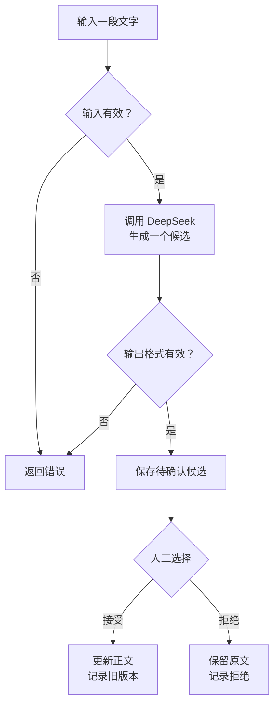

# 01Writing

01Writing 是一个带人工确认环节的 AI 辅助写作工具。使用者输入一段文字后，程序调用 DeepSeek 生成一个修改候选，展示修改结果和原因，再由使用者决定接受或拒绝。每次候选和决定都会保存在本地修订记录中。

## 当前版本

v0.1.0 已实现以下能力：

- 校验输入文字；
- 调用 DeepSeek 生成结构化修改候选；
- 校验模型返回的 JSON、正文和修改原因；
- 在人工决定前保存 `pending` 记录；
- 接受时把候选作为最终正文，拒绝时保留原文；
- 使用本地 JSON 保存原文、候选、模型、状态和时间；
- 使用临时文件替换方式写入，降低数据文件写坏的风险；
- 对配置错误、网络错误、非法模型输出和损坏数据文件给出明确提示。

## 工作流程



## 安装

项目需要 Python 3.11 或更高版本。在 PowerShell 中运行：

```powershell
python -m venv .venv
.\.venv\Scripts\Activate.ps1
python -m pip install -e .
```

## 配置

复制配置模板：

```powershell
Copy-Item .env.example .env
```

打开 `.env`，将占位值替换为自己的 DeepSeek API key：

```dotenv
DEEPSEEK_API_KEY=你的真实密钥
```

`.env` 和 `data/` 已被 `.gitignore` 排除，不会进入正常的 Git 提交。不要把真实密钥填写进 `.env.example`。

## 运行

```powershell
python main.py
```

程序启动后可以选择：

1. 新建修订：依次显示原文、修改候选和修改原因，并等待输入 `y` 或 `n`；
2. 查看修订历史：显示已有记录的状态、原文摘要、最终正文摘要和创建时间，不调用 DeepSeek。

修订记录默认保存到 `data/revisions.json`。

## 测试

```powershell
python -m unittest discover -s tests -p "test_*.py" -v
```

测试不会调用真实 DeepSeek API，也不会消耗 API 额度。

## 项目结构

```text
01Writing/
├─ main.py                         # 便捷启动入口
├─ src/writing_assistant/
│  ├─ cli.py                       # 命令行输入与展示
│  ├─ workflow.py                  # 核心业务流程
│  ├─ validation.py                # 输入和候选校验
│  ├─ models.py                    # 候选和修订记录
│  ├─ config.py                    # 环境变量配置
│  ├─ llm/deepseek.py              # DeepSeek 调用
│  └─ storage/json_store.py        # 本地 JSON 存储
├─ tests/                          # 离线测试
├─ .env.example                    # 安全配置模板
└─ pyproject.toml                  # 项目信息与依赖
```

## 数据记录

每次修订记录包含：

- 唯一 ID；
- 原始文字；
- 修改候选与修改原因；
- 使用的模型；
- `pending`、`accepted` 或 `rejected` 状态；
- 创建时间、决定时间和最终正文。

如果数据文件不是合法 JSON 或结构不符合当前版本，程序会停止写入并保留原文件，避免用新数据覆盖损坏文件。

## 隐私说明

输入文字会发送到所配置的 DeepSeek API，并保存在本机的 JSON 文件中。不要输入无权上传到第三方服务的敏感内容。

## 版本路线

- v0.1.x：完善单次候选、人工确认和本地修订记录。
- v0.2.0：增加历史查看、多轮修订和旧版本恢复。
- 后续版本：在核心工作流稳定后增加 API 或网页界面。
