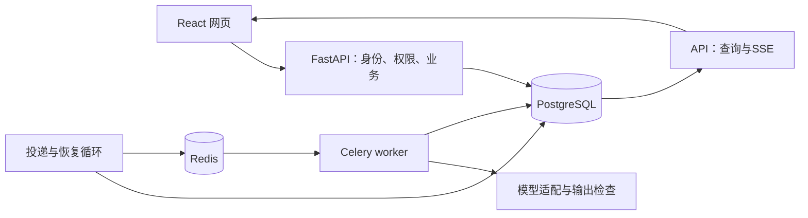

# 全栈写作与 Agent 架构边界

浏览器使用 React、TypeScript、TanStack Query，通过 OpenAPI 生成的请求契约访问 FastAPI。API 与工作进程共享 Python 业务包；PostgreSQL 保存业务结果和任务，Redis／Celery 承担 Linux 部署中的消息传输与执行。Nginx 提供同源网页与接口。

## 正文、候选和任务

正文版本追加保存；文档指向自己的当前版本。用户保存、接受候选或恢复历史都产生新快照。联合外键约束版本、任务来源和恢复来源均属于同一文档。文档行锁串行化写入，基准版本检查拒绝过期提交；重复接受直接返回已有结果。

任务先以 queued 提交到数据库再返回202，任务行也是待投递意图。投递进程扫描到期 queued 行，发出后仍保留数据库状态；发送失败或发出后未领取会再投递。worker 加行锁领取、生成 claim_token 与租约，关闭事务后调用外部模型，再在短事务中核对领取权并保存候选。重复消息不重复执行已领取的任务。

取消会移除领取权；模型结果迟到时仅记录 discarded，不产生候选。租约过期由恢复循环重新排队，尝试达到上限后失败。模型请求的有限超时小于租约预算。外部请求超时可能已经计费，不能保证模型恰好调用一次。每个任务最多3次执行；固定工作流内部最多2次生成／修复，不提供无限自动循环。

## 账户和资源

密码采用 Argon2id；Cookie 是随机会话令牌，数据库只存其 SHA256。HttpOnly Cookie 携带身份，CSRF 随机值通过请求头提交并与数据库哈希比较；来源检查补充防护。登录、注册有数据库限流；文档数量、活跃任务和每日任务有限额。代理不信任客户端自报身份，公网反向代理还应补充可信来源下的入口限流。

每个文档、版本、任务、进度、导出入口都按用户归属查询。writing_app 负责应用读写，writing_owner 负责迁移；应用进程不需要管理数据库的凭证。容器数据库初始安装临时拥有管理能力，初始化末尾移除 writing_owner 的服务器管理权限。账户隔离由 API 授权保证，本版不声称使用 PostgreSQL RLS 实现隔离。

## 观察与评测

TaskEvent 保存状态事件，Attempt 保存尝试、模型、提示词版本、耗时、可得 usage 与失败代码。SSE 读取持久事件，不承担任务执行；重连可以携带事件编号，网页查询负责兜底。完整原稿不会输出到普通请求日志；响应与错误避免包含凭证或供应商异常原文。

50个自建任务对照直接生成、固定流程和Agent，同一任务使用相同授权资料。程序检查与待人工语义评分分开。演示生成器只验证系统链路，不能作为 DeepSeek 效果。真实语义成功率、人工接受率和收益仍需实测。

## 运行范围

本机可使用独立 Python API 和显式 `dispatch --local` 开发执行器。它与生产路径共享状态领取与结果提交逻辑，但不能作为 Celery／Redis 联调证据。正式部署采用 Linux 容器；单机 Compose 提供持久卷，不提供多机高可用。公开部署需要配置域名、HTTPS、Secure Cookie、准确来源和备份策略。

数据库结构由 Alembic 命令在发布时迁移，不由每个 API 进程抢着建表。迁移持有 PostgreSQL 事务级咨询锁。备份使用 pg_dump；恢复应先到隔离数据库检验，再决定正式切换。旧数据导入显式指定接收账户，保留源文件并按内容哈希去重。

## Agent 执行与依据

创建任务时按账户归属读取所选资料和记忆，将当时内容保存为任务快照。模型只看到授权目录，通过只读工具检索片段、读取原文和偏好。当前检索采用关键词与中文双字匹配，并可结合语义向量，不依赖专用向量数据库。新索引每份资料分成最多900字符的片段，优先按段落、句末及PDF页边界切分，同页相邻片段最多重叠120字符，引用编号记录资料序号与字符起点；编号仅在该任务快照内有效。

LangGraph 调度模型节点和工具节点。参数用严格模型校验，工具只能访问当前快照；没有任意SQL、本地文件或代码执行入口；联网只通过单独授权的受限搜索／抓取工具。模型可先检查候选再提交，也可因证据不足请求补充信息并停止。引用标记必须对应已经读取的原文，摘录必须逐字存在；这不能证明摘录语义支持结论，因此仍保留人工核对和接受。

任务检查点由业务层保存到 PostgreSQL，不使用 LangGraph 内置持久检查点服务。每次保存检查执行令牌与租约，模型请求前先预留调用及token预算，响应保存后推进到工具节点；每个工具结果保存后标记已完成，批次完成后才推进下一轮。恢复跳过本批次已经保存结果的工具，未保存结果的调用可能重放；外部请求发出而响应未保存时仍可能重复调用、重复计费，预留预算会限制这类恢复次数。

每任务最多6次模型请求，每次最多4个工具。累计预算48,000 token，单次输出上限4,096，单次执行最多120秒；预算估算使用UTF-8字节和工具描述作保守上界，可能比模型实际上下文容量更早拒绝长文。资料和记忆不是无限追加的聊天记录。记忆需用户明确保存和选择，当前要求优先；拒绝重试沿用原任务依据，后续新建任务重新检查资料权限和有效期。

任务API只返回工具名称、结果、引用位置及引用摘录，不返回完整模型消息或隐藏推理。步骤事件通过原有SSE传到网页；取消立即撤销保存资格，但不能撤销已经发出的供应商请求。资料删除只影响未来新任务，旧任务快照作为历史依据保留。

网页代理使用Docker内部DNS定期解析API地址，避免只更新API容器后继续连接旧地址。单机Compose仍不等同于无停机部署或多机高可用。

## v3 资料与证据链路

上传／链接→API校验与账户配额→ResearchJob提交→投递循环→Celery领取→受限读取／解析→分块／可选Embedding→短事务保存Knowledge及任务完成状态。取消撤销claim_token；计算晚到不能写入。每个导入最多恢复到2次执行，数据库保留任务状态；原始文件base64只在排队／运行时临时保留，结束后清除，持久资料保存提取文字。当前没有原始PDF文件下载归档功能。

导入读取及索引在事务外，保存时锁账户和任务、校验租约；重建索引还比较原内容哈希，防止覆盖用户刚编辑的内容。同账户相同正文与来源URL复用已有条目；不同账户不能共用或读取其资料。

资料分块保留字符起点与页码，不静默丢弃尾部。未配置Embedding走字词匹配；配置后分批取得向量，校验数量、索引、维度和有限数值，向量连同模型／地址指纹保存。查询只在所选快照内计算余弦与关键词排名，经RRF融合取前5条。没有全库向量索引及多租户共享召回。

给定URL抓取不需要搜索API。网络层校验协议、默认端口、凭据、域名和所有DNS解析IP，并固定连接到已校验地址，HTTPS仍验证原域名证书；跳转重新验证。正文最多2MB，不执行JavaScript，不转发用户Cookie。读取有8秒socket超时与25秒循环时间检查；DNS和整体进程还受worker任务时间上限约束，不把循环检查描述为严格25秒总截止时间。PDF通过Linux子进程限制内存512MB、CPU15秒及父进程20秒等待；不支持OCR、加密PDF或超限文档。

搜索支持官方 DeepSeek `/v1/tools/search`，复用 DeepSeek 密钥；Tavily保持兼容。认证请求禁止重定向，响应有大小上限，错误隐藏供应商原文。用户额外授权联网时，search_web仅返回候选链接和摘要；read_web只能读取本轮搜索返回的链接，并保存正文快照。最多2次搜索与3次抓取，调用前保存计数，防止恢复无限重试。正文仍是不具指令权限的数据，工具能力和账户权限不由网页内容改变。

生成后独立核对员检查候选陈述与已读资料的支持关系。输出经Pydantic校验，claim必须属于候选，quote必须属于对应片段，supported／contradicted必须提供有效依据。模型仍可能误判含义，因此界面保持人工确认，未完成核对也不会自动更新正文。该阶段有单独提示版本和用量记录；共享Agent调用预算，服务失败或预算不足明确标记unavailable。

实现参考：[DeepSeek搜索接口](https://api-docs.deepseek.com/zh-cn/api/search/)、[硅基流动Embedding接口](https://docs.siliconflow.cn/docs/api/embeddings-post)、[Tavily搜索接口](https://docs.tavily.com/documentation/api-reference/endpoint/search)、[pypdf文字提取限制](https://pypdf.readthedocs.io/en/stable/user/extract-text.html)、[OWASP SSRF防护](https://cheatsheetseries.owasp.org/cheatsheets/Server_Side_Request_Forgery_Prevention_Cheat_Sheet.html)。这些措施提供明确边界，不承诺任意互联网内容均能抓取或模型完全免受提示注入影响。

## v4：索引版本与证据判断

导入任务先在事务外请求Embedding，成功后在短事务中写资料索引与片段。`wa_source_indexes`用账户、内容、标题、模型和切分信息区分不可变版本；`wa_source_chunks`以索引和原文偏移定位，并用复合外键保持片段与索引属于同一账户。旧索引不原地改写，重建失败回滚。兼容期间资料保留JSON索引，新任务快照不再复制向量，而引用数据库索引ID；因此仍有一份兼容存储的空间开销。

worker从数据库读取任务所有者及任务持久化的索引ID集合。SQL先生成授权子集，限定同模型和同维度后使用pgvector精确余弦距离排序。模型不能提供任意SQL、账户或索引授权。Embedding网络请求在两个短数据库会话之间完成，不持有事务等供应商。当前选择精确查询以便校验正确性；HNSW仅在独立临时表实验，不能把有ANN实验写成生产启用了ANN。

检索合并词法与向量排名，再从命中片段选择句段和相邻限定语；每窗最多420字符、总计1800字符、最多6窗。同来源重叠区间不重复带入。窗口可能丢掉远处上下文；全无关键词时的局部窗口排序也可能选错，因此没有保证语义完整。`read_source`仍可读取原片段，所有历史工具结果受整体上下文和调用预算限制。

模型按当前要求列出事实需求与证据。程序只核实摘录存在、要求有证据以及缺失项不为空；无法证明模型列全了要求、判断了真实支持关系。充分才允许有资料的候选提交；发现缺失可补查，判断冲突则直接结束本轮等待用户，不继续猜测。之后的独立证据核对仍是辅助判断，真正的正文更新需要用户接受。旧检查点保留旧提示和继续路径，新任务采用agent-v4.0.2。

索引没有跨用户共享缓存，没有自动删除历史索引或自动遗忘机制。历史快照保留属于当前产品行为，后续数据删除与保留策略需要单独设计，不能把页面删资料等同完全擦除。

## v5 继续修订、计量与保留

资料不足时，Agent保存检查点和`evidence_needed`失败码。网页将它显示为“等待补充信息”。POST `/tasks/{id}/clarify`使用用户行→文档行→原任务行的锁顺序，核对所有者、正文版本、原状态和幂等键；重新读取本次选择的资料，建立全新的Task、空检查点和父任务链接。补充记录独立保存在新上下文中，最多四轮，原Task不被改写。原样失败重试复制旧上下文，拒绝重试还加入候选和拒绝原因，两者与补充资料入口分开。

请求编号由服务端生成，写入Task.context和queued事件，并返回X-Request-ID。一个Task对应多个Attempt及TaskEvent；Agent每个调用槽位在请求前预留，检查点先持久化。计量按槽位去重，避免恢复后把历史调用累计多次。无槽位的基线调用按Attempt计数。金额不估算，Embedding与搜索账单不在聊天Token总计里。

账户统计按创建时间限制最近1—90天、最多9000条，只查询当前用户；接受率仅比较accepted/rejected。工具时间包含检索，不能与检索时间重复相加。旧任务没有完整分阶段计时，不可用旧零值证明操作无耗时。

SourceIndex不可变；清理只处理来源已不存在、索引创建至少7天且没有Task.context.sources引用的记录。清理与新快照共用User行锁，避免检查后另一个请求刚好建立引用；SourceChunk随索引级联删除。每批最多100条，默认dry-run。仍有来源的过时索引保守保留；本文档、任务和快照没有自动删除政策。

发布验证从本机隔离测试到GitHub Linux真实队列和容器，再到本机备份/恢复/升级。依赖使用锁文件；数据库恢复校验所有业务表行数和内容哈希。v5不修改v4表结构，版本回退只切换应用镜像；未来若出现不兼容迁移，不能套用这一回退方式。
