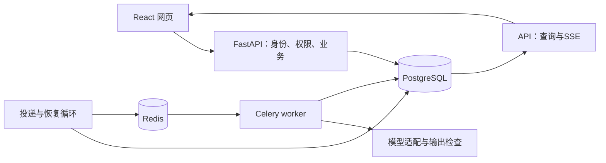

# v1.0 架构与工程边界

浏览器使用 React、TypeScript、TanStack Query，通过 OpenAPI 生成的请求契约访问 FastAPI。API 与工作进程共享 Python 业务包；PostgreSQL 保存业务结果和任务，Redis／Celery 承担 Linux 部署中的消息传输与执行。Nginx 提供同源网页与接口。

## 正文、候选和任务

正文版本追加保存；文档指向自己的当前版本。用户保存、接受候选或恢复历史都产生新快照。联合外键约束版本、任务来源和恢复来源均属于同一文档。文档行锁串行化写入，基准版本检查拒绝过期提交；重复接受直接返回已有结果。

任务先以 queued 提交到数据库再返回202，任务行也是待投递意图。投递进程扫描到期 queued 行，发出后仍保留数据库状态；发送失败或发出后未领取会再投递。worker 加行锁领取、生成 claim_token 与租约，关闭事务后调用外部模型，再在短事务中核对领取权并保存候选。重复消息不重复执行已领取的任务。

取消会移除领取权；模型结果迟到时仅记录 discarded，不产生候选。租约过期由恢复循环重新排队，尝试达到上限后失败。模型请求的有限超时小于租约预算。外部请求超时可能已经计费，不能保证模型恰好调用一次。每个任务最多3次执行；固定工作流内部最多2次生成／修复，不提供无限自动循环。

## 账户和资源

密码采用 Argon2id；Cookie 是随机会话令牌，数据库只存其 SHA256。HttpOnly Cookie 携带身份，CSRF 随机值通过请求头提交并与数据库哈希比较；来源检查补充防护。登录、注册有数据库限流；文档数量、活跃任务和每日任务有限额。代理不信任客户端自报身份，公网反向代理还应补充可信来源下的入口限流。

每个文档、版本、任务、进度、导出入口都按用户归属查询。writing_app 负责应用读写，writing_owner 负责迁移；应用进程不需要管理数据库的凭证。容器数据库初始安装临时拥有管理能力，初始化末尾移除 writing_owner 的服务器管理权限。账户隔离由 API 授权保证，本版不声称使用 PostgreSQL RLS 实现隔离。

## 观察与评测

TaskEvent 保存状态事件，Attempt 保存尝试、模型、提示词版本、耗时、可得 usage 与失败代码。SSE 读取持久事件，不承担任务执行；重连可以携带事件编号，网页查询负责兜底。完整原稿不会输出到普通请求日志；响应与错误避免包含凭证或供应商异常原文。

20个自建任务校准 A直接调用与B固定流程，程序检查与待人工语义评分分开。演示生成器只验证系统链路，不能作为 DeepSeek 效果。v1 没有资料检索、引用核验和动态 Agent 工具循环，它们属于后续版本。

## 运行范围

本机可使用独立 Python API 和显式 `dispatch --local` 开发执行器。它与生产路径共享状态领取与结果提交逻辑，但不能作为 Celery／Redis 联调证据。正式部署采用 Linux 容器；单机 Compose 提供持久卷，不提供多机高可用。公开部署需要配置域名、HTTPS、Secure Cookie、准确来源和备份策略。

数据库结构由 Alembic 命令在发布时迁移，不由每个 API 进程抢着建表。迁移持有 PostgreSQL 事务级咨询锁。备份使用 pg_dump；恢复应先到隔离数据库检验，再决定正式切换。旧数据导入显式指定接收账户，保留源文件并按内容哈希去重。
